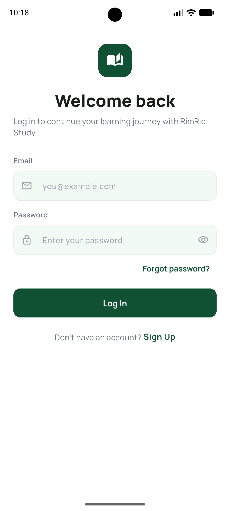
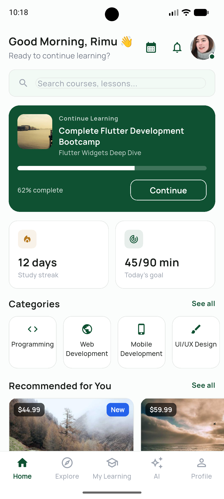
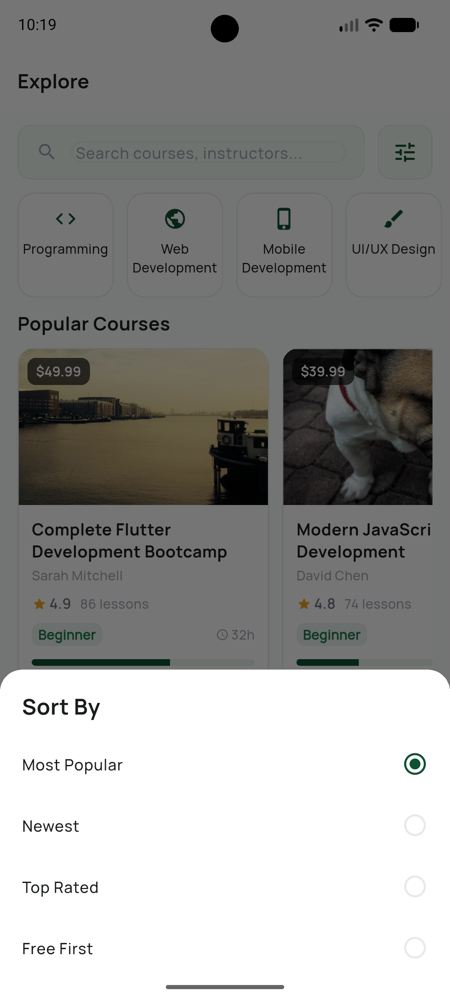
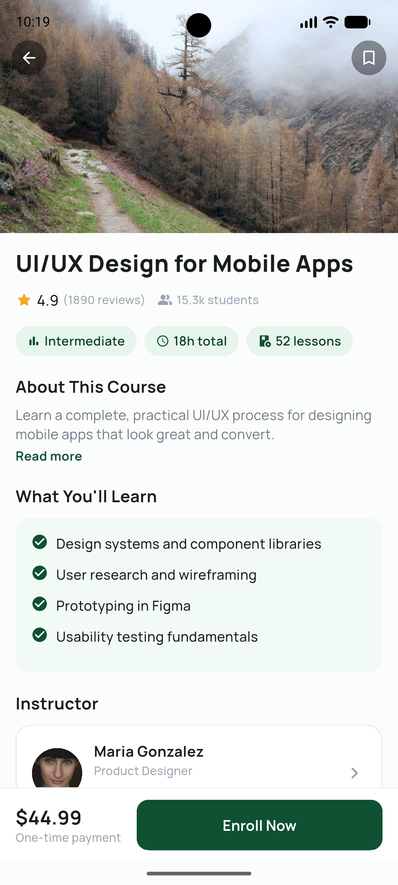
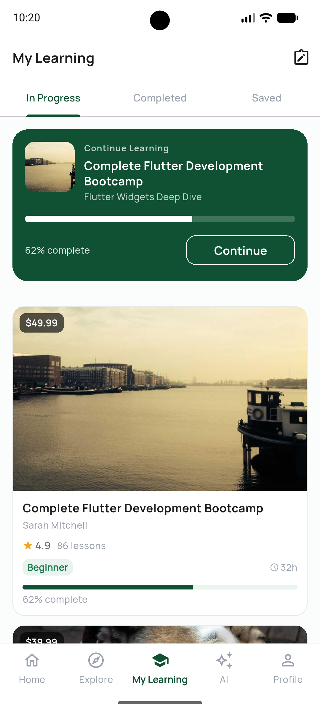
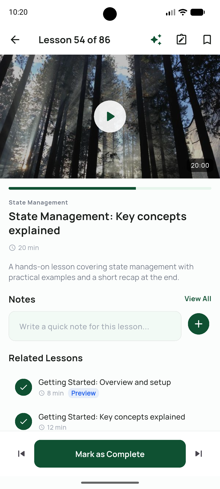
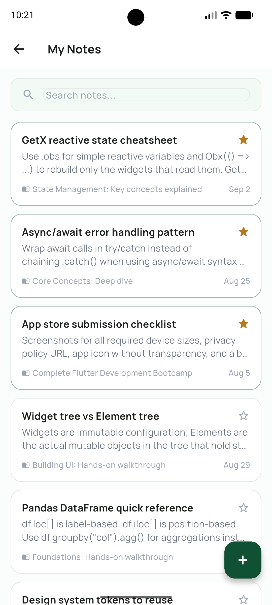
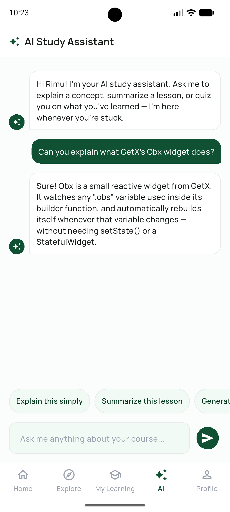
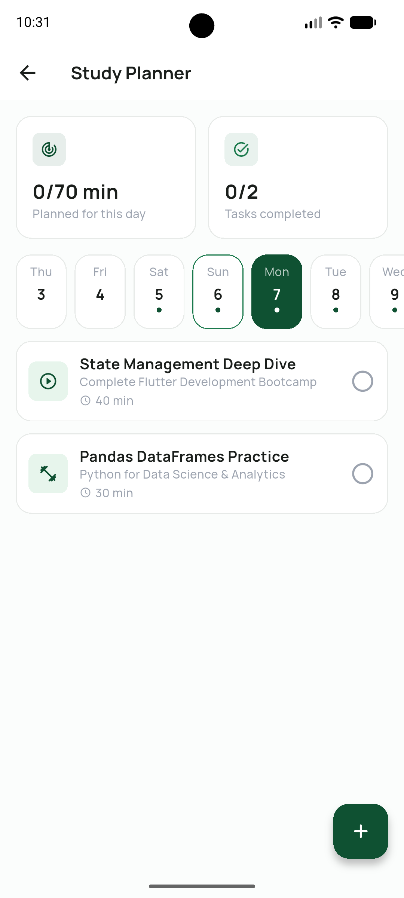

# RimRid Study

A premium, modern AI-powered course & study mobile app built with Flutter and GetX.

RimRid Study helps learners follow structured courses, track progress, take notes, plan study sessions, and get unstuck with an AI study assistant — all wrapped in a clean, dark-green EdTech design.

## Screenshots

<table>
  <tr>
    <td align="center" width="33%">
      <br/>
      <sub><b>Login</b></sub>
    </td>
    <td align="center" width="33%">
      <br/>
      <sub><b>Home Dashboard</b></sub>
    </td>
    <td align="center" width="33%">
      <br/>
      <sub><b>Explore & Sort</b></sub>
    </td>
  </tr>
  <tr>
    <td align="center">
      <br/>
      <sub><b>Course Details</b></sub>
    </td>
    <td align="center">
      <br/>
      <sub><b>My Learning</b></sub>
    </td>
    <td align="center">
      <br/>
      <sub><b>Lesson / Video Player</b></sub>
    </td>
  </tr>
  <tr>
    <td align="center">
      <br/>
      <sub><b>My Notes</b></sub>
    </td>
    <td align="center">
      <br/>
      <sub><b>AI Study Assistant</b></sub>
    </td>
    <td align="center">
      <br/>
      <sub><b>Study Planner</b></sub>
    </td>
  </tr>
</table>

## Features

- **Onboarding & Auth UI** — splash, 3-step onboarding, login, register, forgot password
- **Home Dashboard** — greeting, continue learning, study streak, daily goal, categories, recommended/popular courses, upcoming quizzes
- **Course Discovery** — search, category filters, sort (Most Popular / Newest / Top Rated / Free First)
- **Course Details** — curriculum with expandable modules, what you'll learn, instructor, reviews
- **My Learning** — in progress, completed, and saved courses with visual progress
- **Lesson / Video Player** — progress tracking, resources, notes, related lessons
- **Notes** — create, search, and star important notes linked to a lesson/course
- **AI Study Assistant** — chat UI with suggested prompts (explain simply, summarize, generate quiz, etc.)
- **Quiz** — intro, timed questions, results with accuracy breakdown
- **Study Planner** — weekly calendar strip, daily goals, task tracking
- **Progress & Analytics** — study hours, streaks, weak/strong topics
- **Certificates** — completed course certificates
- **Profile & Notifications**

## Tech Stack

- **Flutter** with **GetX** for state management, routing, and dependency injection
- Feature-based architecture (`lib/features/<feature>/{controllers,views,bindings,widgets}`)
- **Manrope** (Google Fonts) typography, dark-green EdTech theme
- All data currently served from local mock repositories (`lib/data/mock`), structured so real Supabase/API repositories can be swapped in later without UI changes

## Project Structure

```
lib/
  core/           # theme, routes, services, responsive helpers
  data/
    models/       # plain Dart models
    mock/         # mock data sources (stand-ins for future API/Supabase)
  features/       # one folder per screen/feature (bindings, controllers, views, widgets)
  shared/widgets/ # reusable components (CourseCard, StatCard, AIMessageBubble, etc.)
```

## Getting Started

```bash
flutter pub get
flutter run
```

This project currently uses mock/local data only — no backend, authentication, or payment integration is wired up yet.
